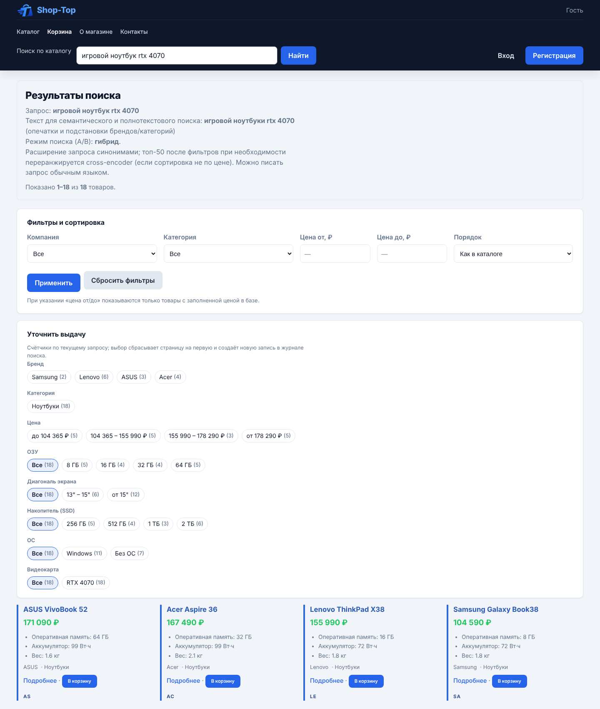
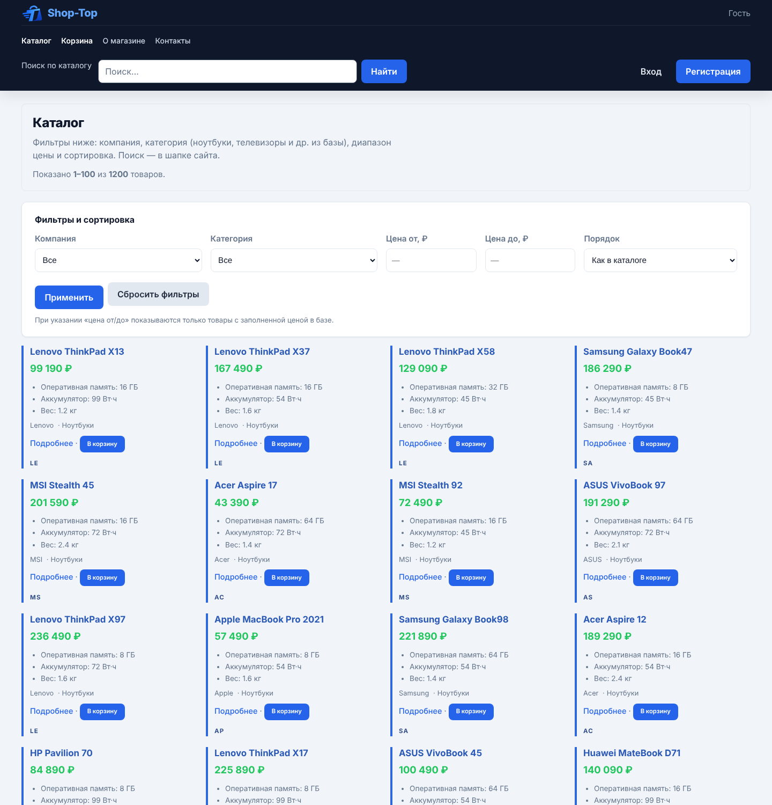
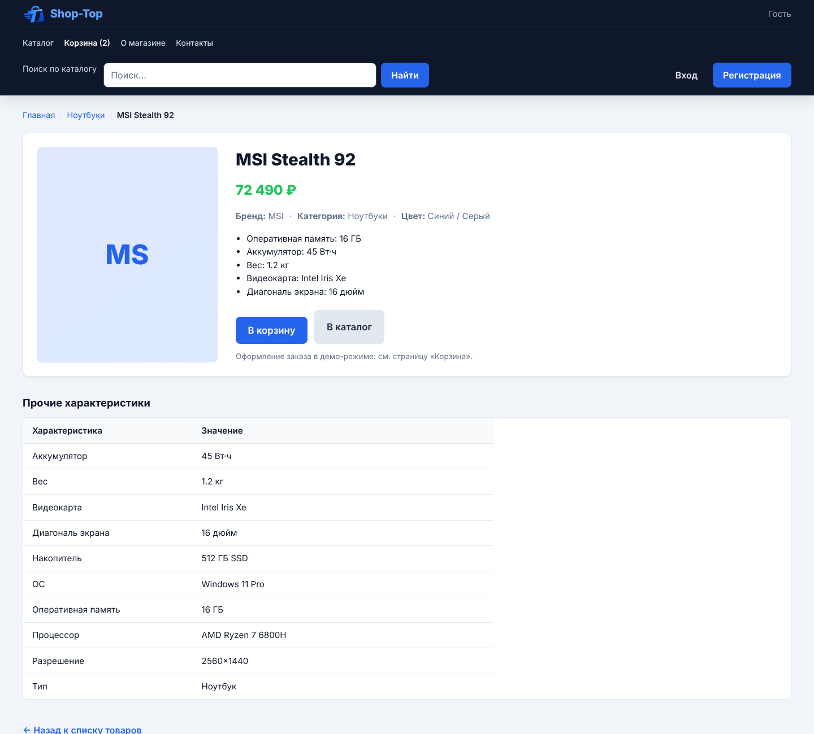
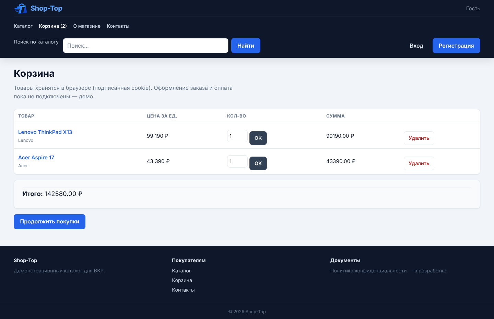
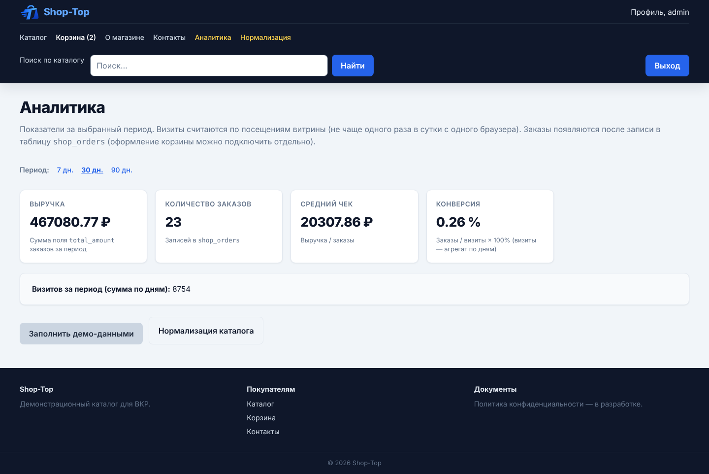
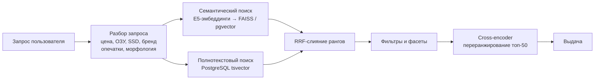

<p align="center">
  <picture>
    <source media="(prefers-color-scheme: dark)" srcset="docs/logo/logo-horizontal-dark.svg">
    
  </picture>
</p>

# Shop-Top — интернет-магазин электроники с интеллектуальным поиском

[](https://github.com/Andrew8219/Shop-Top/actions/workflows/ci.yml)


Веб-витрина магазина электроники с **гибридным поиском** (семантика + полнотекст), пониманием запросов на естественном языке («игровой ноутбук до 100 тысяч с RTX 4070») и админ-панелью для **нормализации характеристик** каталога с помощью ML.

Проект выполнен как выпускная квалификационная работа (ВКР): помимо самого приложения в нём есть методика и скрипты оценки качества поиска (Recall@K, MRR@K, nDCG@K).



## Возможности

**Поиск**
- Гибридный поиск: семантические эмбеддинги (`multilingual-e5`, sentence-transformers) + полнотекстовый поиск PostgreSQL (`tsvector`, `websearch_to_tsquery`), объединение рангов методом **Reciprocal Rank Fusion**.
- Векторный поиск через **FAISS** или **pgvector**, переранжирование топа **cross-encoder**-моделью.
- Разбор запроса на естественном языке: цена («до 50000», «от 30 тыс»), объём ОЗУ/SSD, диагональ, ОС, видеокарта.
- Исправление опечаток в брендах и категориях (**rapidfuzz**), морфология русского языка (**pymorphy3**), словарь намерений и синонимов, удаление «разговорных» слов.
- Динамические фасеты по выдаче (бренд, категория, цена, ОЗУ, SSD, диагональ, ОС, GPU) и автодополнение (`/search/suggest`).
- Логирование запросов для последующего анализа качества.
- Деградация без потерь: если ML-модели недоступны, поиск работает на полнотексте.

**Админ-панель**
- Нормализация значений характеристик: кластеризация (TF-IDF по символьным n-граммам + агломеративная кластеризация) с предпросмотром изменений перед применением.
- Группировка названий характеристик дообученным трансформер-классификатором (с fallback на кластеризацию).
- Сборка поискового индекса в фоне с отображением прогресса.
- Аналитика витрины: выручка, число заказов, средний чек, конверсия, визиты.

**Витрина**
- Каталог с фильтрами и сортировкой, карточки товаров с группами характеристик, корзина в подписанной cookie.
- Регистрация и вход: JWT в httpOnly-cookie (SameSite=Lax), хеширование паролей PBKDF2-SHA256, ограничение частоты попыток входа.

## Скриншоты

| Каталог | Карточка товара |
|---|---|
|  |  |
| **Корзина** | **Аналитика (админ)** |
|  |  |

## Как устроен поиск



## Оценка качества

На размеченном наборе из 25 запросов к реальному каталогу (≈2 800 товаров) сравнивались четыре режима ранжирования (`scripts/evaluate_vkr.py`, методика — в [`evaluation/task7_methodology.md`](evaluation/task7_methodology.md)):

| Режим | Recall@10 | MRR@10 | nDCG@10 |
|---|---:|---:|---:|
| Только полнотекст (PostgreSQL FTS) | 0.459 | 0.427 | 0.440 |
| Только семантика (E5 + FAISS) | 0.875 | 0.743 | 0.774 |
| **Гибрид RRF** | **0.885** | **0.810** | **0.816** |
| Гибрид RRF + строгий постфильтр по токенам | 0.467 | 0.437 | 0.433 |

Гибридный поиск даёт прирост ~+90% Recall@10 относительно полнотекстового. Эксперимент также показал, что строгая постфильтрация «все слова запроса должны встретиться в карточке» резко снижает полноту, поэтому в витрине используется мягкий вариант фильтра с откатом к исходным кандидатам. Полный отчёт: [`evaluation/reports/vkr_metrics.md`](evaluation/reports/vkr_metrics.md).

> Исходный каталог в репозиторий не входит, поэтому для запуска используются сгенерированные демо-данные; метрики выше получены на исходных данных.

## Технологии

| Область | Инструменты |
|---|---|
| Backend | Python, FastAPI, Uvicorn, Jinja2 (SSR) |
| База данных | PostgreSQL 16, SQLAlchemy 2.0, psycopg 3, pgvector, полнотекстовый поиск (GIN) |
| ML / поиск | sentence-transformers (multilingual-e5), cross-encoder, FAISS, PyTorch, Hugging Face Transformers, scikit-learn |
| NLP | rapidfuzz, pymorphy3, собственный словарь намерений |
| Безопасность | JWT (python-jose), passlib (PBKDF2), подписанные cookie, rate limiting |
| Фронтенд | HTML, CSS (без фреймворков), немного vanilla JS |
| Инфраструктура | Docker, Docker Compose, GitHub Actions, pytest |

## Быстрый старт

### Docker

```bash
docker compose up -d --build
docker compose exec app python -m scripts.generate_fake_data 1000   # демо-каталог
docker compose exec app python -m scripts.create_admin admin          # администратор
```

Откройте http://localhost:8000, войдите под администратором и нажмите **«Нормализация → Собрать поисковый индекс»**.

По умолчанию образ собирается без PyTorch (полнотекстовый поиск). Для семантического поиска поменяйте в `docker-compose.yml` `WITH_ML: "1"`.

### Локально

```bash
python -m venv .venv && source .venv/bin/activate
pip install -r requirements.txt
pip install -r requirements-ml.txt        # опционально: семантический поиск

cp .env.example .env                       # укажите DATABASE_URL и SECRET_KEY
docker compose up -d db                    # или свой PostgreSQL

python -m scripts.generate_fake_data 1000
python -m scripts.create_admin admin
uvicorn main:app --reload
```

## Структура проекта

```
├── main.py                  # FastAPI-приложение: маршруты витрины, поиска и админки
├── models.py, db.py         # модели SQLAlchemy и подключение к БД
├── search_index.py          # эмбеддинги, FAISS/pgvector, FTS, RRF, cross-encoder
├── search_smart.py          # разбор запроса, опечатки, синонимы, подсказки
├── search_intent_lexicon.py # словарь намерений и разговорных слов
├── search_facets.py         # фасеты и фильтры по характеристикам
├── normalization.py         # нормализация значений и группировка характеристик
├── analytics.py             # метрики витрины
├── cart_cookie.py           # корзина в подписанной cookie
├── templates/, static/      # Jinja2-шаблоны и стили
├── scripts/                 # генерация данных, обучение моделей, оценка качества
├── evaluation/              # методика, размеченные запросы и отчёты по метрикам
├── experimental/            # интеграция с Ollama (Qwen3) — в разработке, не подключена
├── migrations/              # SQL-миграции
└── tests/                   # unit-тесты разбора запросов
```

## Скрипты

| Команда | Назначение |
|---|---|
| `python -m scripts.generate_fake_data N` | сгенерировать N демо-товаров по 12 категориям |
| `python -m scripts.create_admin USER` | создать администратора |
| `python -m scripts.evaluate_vkr` | посчитать Recall/MRR/nDCG для режимов поиска |
| `python -m scripts.eval_search_quality` | анализ качества по логам поиска |
| `python -m scripts.train_search_model` | дообучение bi-encoder на данных каталога |
| `python -m scripts.train_prop_groups_llm` | обучение классификатора групп характеристик |

## Тесты

```bash
pip install -r requirements-dev.txt
python -m pytest -q
```
